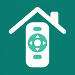

  

<h1 align="center">Harmony Home Control</h1>

<strong>Your favorite remote. More of your home.</strong>

Bring Hue lights and Homebridge accessories within thumb’s reach.

  <a href="#get-started">Get started</a> ·
  <a href="#button-ideas">Button ideas</a> ·
  <a href="#what-youll-need">Compatibility</a> ·
  <a href="docs/troubleshooting.md">Get help</a>

---

## Same remote. A few new tricks.

Lights down. Fan on. Settle in.

**Harmony Home Control** gives your Logitech Harmony remote a few jobs beyond the TV. Choose real Hue devices and existing Homebridge accessories, map them to buttons, and put those everyday controls where your hand already is.

- 💡 **Bring your Hue lights along.** Combine selected lights, plugs, and groups from multiple physical Hue bridges.
- 🧩 **Pick your Homebridge favorites.** Browse accessories by name, type, or bridge—including individual child bridges.
- 🎛️ **Give spare buttons a job.** Set a value, toggle a control, or adjust a supported numeric value.
- ✨ **Keep Apple Home tidy.** Commands go to your existing devices; the plugin creates no duplicate HomeKit accessories.
- 🔎 **Inspect your Harmony setup.** Enable the optional [configurator](docs/configurator.md) in this plugin’s child bridge to inspect devices and activities, record HDMI/CEC details, and review changes and suggestions.

> [!NOTE]
> **Early preview (alpha).** Automated tests cover the protocols and configuration UI. Physical Harmony discovery, pairing, button behavior, and HTTP-port compatibility still need confirmation. Start with one lamp while you check your setup.

## Button ideas

A few ways to make the sofa command center a little more useful:

| On your remote | In your room | Mapping |
| --- | --- | --- |
| Short press / long press on a home-control button | Reading lamp on / off | Hue |
| Dimming rocker | Bring the lights down a notch | Hue |
| Spare button in a Harmony activity | Toggle the ceiling fan | Roku |
| Another spare activity button | Send the blinds to a chosen position | Roku |

Available actions depend on the controls your accessory exposes. The setup screen lets you choose and test them before assigning your remote buttons.

### Two ways in. One place to set them up.

| Dedicated home-control buttons | Other activity buttons |
| --- | --- |
| A **virtual Hue bridge** presents your selected devices to Harmony. | A **virtual Roku** gives Harmony familiar commands to send. |
| Use the light/plug buttons for on/off and the dimming rocker where supported. | Map a command such as **Play** to an accessory action, then assign it to a button in an activity. |

The virtual Roku acts as a translator. **Play** can mean “turn on the fan” here. An actual Roku device is not required.

## Get started

1. **Install the preview.** Follow the [GitHub installation guide](docs/setup.md#install-from-github), then open **Plugins → Harmony Home Control → Settings**.
2. **Choose your devices.** Enter your Harmony hub’s address, optionally connect real Hue bridges, and find your accessories.
3. **Give a button its job.** Add a mapping, test it, save, and restart the plugin’s bridge. Use **Connect Harmony** to pair the virtual Hue bridge or Roku and assign your buttons.

The settings screen follows Homebridge’s light or dark theme and fits mobile screens. Search sits right above the accessory chooser. **Device Source Filter** and **Accessory types Filter** expand when you need them; the save bar keeps track of your changes.

**If Harmony already has a Hue bridge:** Harmony supports one Hue bridge per hub. To use the combined bridge, replace Harmony’s existing Hue connection and recreate affected lighting assignments. Your physical Hue bridges can stay connected to the Hue app and Apple Home. [Read the pairing steps first →](docs/setup.md#2-dedicated-home-control-buttons-hue)

## What you’ll need

| Bring this | Details |
| --- | --- |
| **Harmony hub + compatible remote** | Dedicated home-control buttons are needed for the Hue button route. |
| **Homebridge + Homebridge UI** | Homebridge 1.8+ or 2.x, with Node.js 22.13 or newer. |
| **Something to control** | Existing Homebridge accessories, a supported real Hue bridge, or both. |
| **A reachable local network** | Stable IPv4 addresses for Homebridge and Harmony. [Separate VLANs are covered here.](docs/network.md) |

Direct Hue connections support the **square Hue Bridge (BSB002)** and **Hue Bridge Pro (BSB003)**. Homebridge accessory targets need accessory control enabled; if Homebridge UI’s **Accessories** page works, this is usually already set up.

## A few useful details

<strong>Bring more than one real Hue bridge</strong>

Connect each physical bridge in the settings and authorize it with its link button. Choose devices from any of them, alongside your Homebridge accessories. Harmony sees one combined virtual Hue bridge.

Direct Hue control works independently of `homebridge-hue` and does not require a Hue cloud login. If you also use `homebridge-hue`, set its **Bridges** (`hosts`) list to your real bridges so it does not discover this plugin’s emulator.

<strong>Keep the accessory list focused</strong>

Harmony accessories are hidden by default because your remote already controls them. **Other / custom** and **Setup & maintenance** types also start unchecked. You can include them deliberately in the filters.

Filters help you browse; they do not disable saved mappings. [Explore the picker →](docs/setup.md#1-connection)

<strong>Know which devices and actions are in reach</strong>

The plugin can target Homebridge accessories and devices on directly connected, supported Hue bridges. It does not browse everything paired to Apple Home. A device available only through Apple Home needs a Homebridge virtual switch linked to an Apple Home automation.

Direct Hue support covers on/off and supported brightness controls, including groups. Hue scenes, color, color temperature, schedules, and timed transitions are not implemented. The original round Hue bridge and emulated Hue/deCONZ bridges are not supported as direct Hue sources.

## Take the next step

| You want to… | Head here |
| --- | --- |
| Set up your first button | [Setup guide](docs/setup.md) |
| Inspect activities, power settings and HDMI/CEC behavior | [Optional Harmony configurator](docs/configurator.md) |
| Connect across VLANs or use containers | [Network guide](docs/network.md) |
| Find out why a button does nothing | [Troubleshooting](docs/troubleshooting.md) |
| Contribute or explore the protocols | [Development & references](docs/development.md) |
| Share feedback | [GitHub issues](https://github.com/pponce/homebridge-harmony-home-control/issues) |

---

   
  <strong>One remote. Your connected home.</strong> 
  <a href="assets/icon-large.png">Large icon · 1024 px</a> · <a href="assets/icon-small.png">Small icon · 128 px</a> · <a href="LICENSE">MIT license</a>

A community project. Not affiliated with Logitech, Philips/Signify, Roku, or Apple.

